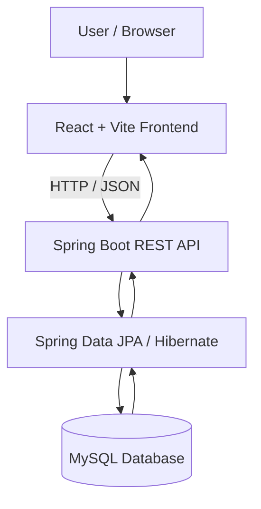

# TripaHolidays — Travel & Holiday Booking Website

A full-stack travel website designed to help users explore holiday destinations, discover travel packages, and submit enquiries for personalized trips.

## Overview

**TripaHolidays** aims to provide a convenient platform for browsing holiday packages and planning travel experiences through a responsive web interface and a backend REST API.

## Features

- **Holiday Packages** — Explore travel packages and destination details.
- **Destination Discovery** — Browse destinations and travel experiences.
- **Travel Enquiries** — Submit enquiries for customized holiday plans.
- **User Management** — Support for user accounts and authentication, where implemented.
- **Responsive Interface** — Access the website on desktop, tablet, and mobile.
- **REST API Backend** — Handle application data and frontend requests.
- **Database Integration** — Persist application information using MySQL.

> Note: Confirm each feature against the current source code before describing it as production-ready.

## Technology Stack

| Layer | Technology |
|---|---|
| Frontend | React.js, Vite |
| Backend | Java, Spring Boot 3.3.x |
| API | REST APIs |
| Database | MySQL |
| Persistence | Spring Data JPA, Hibernate |
| Security | Spring Security and JWT, where configured |
| Build Tool | Maven |
| Backend Server | Embedded Apache Tomcat |
| API Testing | Postman |

## Architecture



## Project Structure

The following is a suggested structure for the project. Update it to match the actual repository.

```text
TripaHolidays/
├── frontend/
│   ├── public/
│   ├── src/
│   │   ├── assets/
│   │   ├── components/
│   │   ├── pages/
│   │   ├── services/
│   │   └── App.jsx
│   ├── package.json
│   └── vite.config.js
│
├── backend/
│   ├── src/
│   │   └── main/
│   │       ├── java/
│   │       └── resources/
│   ├── pom.xml
│   └── mvnw
│
└── README.md
```

## Prerequisites

Install the following tools before running the application:

- Node.js and npm
- Java Development Kit (JDK) compatible with the backend
- Maven
- MySQL Server
- Git

## Installation and Setup

### 1. Clone the repository

```bash
git clone <THIS_REPOSITORY_URL>
cd TripaHolidays
```

Replace `<THIS_REPOSITORY_URL>` with your actual Git repository URL.

### 2. Configure the database

Create a MySQL database:

```sql
CREATE DATABASE tripaholidays;
```

Configure the database connection in the backend's `application.properties` or environment variables.

Example:

```properties
spring.datasource.url=${DB_URL:jdbc:mysql://localhost:3306/tripaholidays}
spring.datasource.username=${DB_USERNAME:root}
spring.datasource.password=${DB_PASSWORD}

spring.jpa.hibernate.ddl-auto=update
```

Adjust the database name, credentials, port, and JPA configuration to match your existing backend. Never commit production database credentials.

### 3. Start the backend

```bash
cd backend
mvn clean install
mvn spring-boot:run
```

The previously observed backend configuration used port `8085`. Confirm the current `server.port` setting before testing.

### 4. Start the frontend

Open a second terminal:

```bash
cd frontend
npm install
npm run dev
```

Open the local URL printed by Vite in your terminal, typically `http://localhost:5173`.

If the frontend requires a backend API URL, configure it using the environment variable expected by the existing code.

## API Configuration

The React application should communicate with the Spring Boot backend through its configured REST API base URL.

Example frontend environment file:

```env
VITE_API_BASE_URL=http://localhost:8085
```

Use the variable name actually referenced by the frontend code. Configure CORS on the backend for the frontend's development and production origins.

## Running Tests

Backend:

```bash
cd backend
mvn test
```

Frontend:

```bash
cd frontend
npm run
```

Use the available scripts listed by npm to run the frontend's configured checks or tests.

## Deployment

The application can be deployed using a suitable hosting environment:

- **Frontend:** Vercel, Nginx, or another static/frontend hosting service.
- **Backend:** AWS EC2 or another Java-compatible hosting platform.
- **Database:** MySQL on a secured server or a managed database service.
- **HTTPS:** Configure TLS using a domain and a valid certificate.

Set production environment variables, restrict database access, configure CORS, and keep secrets out of source control.

## Security

- Store secrets in environment variables.
- Never commit `.env` files containing credentials.
- Restrict CORS to trusted frontend origins.
- Validate incoming API requests.
- Use HTTPS in production.
- Protect authenticated endpoints using the security mechanisms actually implemented.

## Future Enhancements

- Advanced destination and package search
- Filters by budget, duration, and travel theme
- Booking and enquiry management
- Online payment integration
- Booking confirmation notifications
- Admin dashboard for managing packages
- Automated deployment and monitoring

## Contributing

1. Fork the repository.
2. Create a feature branch.
3. Implement and test your changes.
4. Submit a pull request with a clear description.

## License

Add the appropriate license for this project before making the repository publicly available.
